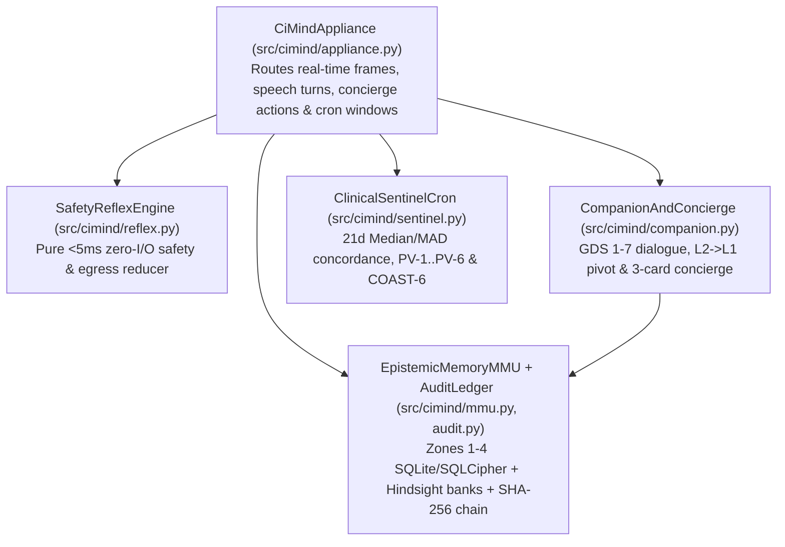

# CiMind

[](https://github.com/TinkeringDao/CiMind/actions/workflows/ci.yml)
[](https://github.com/TinkeringDao/CiMind/actions/workflows/security.yml)
[](https://doi.org/10.5281/zenodo.24504102)
[](LICENSE)

Local-first, zero-cloud, auditable cognitive prosthetic and ambient-safety kernel for dementia and mild cognitive impairment (MCI) assistive-living research across Reisberg functional stages (`GDS 1–7`).

`CiMind` (`TinkeringDao Labs` — [`tinkeringdao.dev/research/cimind/`](https://tinkeringdao.dev/research/cimind/)) treats any local language model strictly as an untrusted reasoning coprocessor behind deterministic Python verification seams. Life-safety reflexes, epistemic memory boundaries, stage-adaptive dialogue rules, commerce velocity caps, and longitudinal observational baselines execute in pure, offline-verifiable Python (`3.11+` standard library only; zero third-party runtime dependencies) backed by an append-only SHA-256 hash-chained SQLite audit ledger. For full primary-source clinical and engineering citations (`PMID`, `NCT`, `CIE S 026`, `arXiv`) and the `v0.2.0` kernel-vs-adapter boundary matrix, see [`docs/CLINICAL_AND_SYSTEMS_EVIDENCE_RATIONALE.md`](docs/CLINICAL_AND_SYSTEMS_EVIDENCE_RATIONALE.md).

---

## Core Design Invariants

| Assistive-Care Failure Mode | Deterministic `CiMind` Guardrail | Module |
| :--- | :--- | :--- |
| Confabulated medication claims, TV dialogue bleed, or phantom sensor assumptions | Four isolated epistemic zones (`ClinicalVault`, `VerifiedBiography`, `SensorEpisodeBank`, `PatientUtteranceQuarantine`), 4-gate VAD/SNR/near-field broadcast filter, and explicit `UnobservedModalitiesHeader` | [`src/cimind/mmu.py`](src/cimind/mmu.py) |
| NPU/LLM inference stalls on fall detection, nighttime wandering, or perimeter locks | Pure `< 5 ms`, zero-I/O reducer evaluating camera-free `2-of-3` floor fusion (`60 GHz mmWave` + `32x24` thermal + `15 cm dToF`/piezo), `590 nm` bed-exit strip, `0V` fail-safe geolock cutouts, and 4-state `BLE/UWB -> LoRaWAN GNSS` handover | [`src/cimind/reflex.py`](src/cimind/reflex.py) |
| Reality-orientation quizzes, bereavement re-traumatization, `L2` attrition, or impulsive purchases | Stage-governed `TherapeuticMode` (`PeerCoPilot` -> `GuidedConcierge` -> 3-step `IntegrativeValidation` -> dysphagia-safe `SensoryPalliative`), intra-turn `L2 -> L1` mother-tongue pivot, `>= 40%` `Ikigai` role-reversal quota, seated `GDS <= 3` `Cognicise`, and velocity-capped 3-card `Co-Agency Concierge` | [`src/cimind/companion.py`](src/cimind/companion.py) |
| Afebrile UTIs, prescribing cascades (`ChEI -> antimuscarinic`), or single-sensor alarm fatigue | `21`-day intra-patient `Median/MAD` (`\|z\| >= 2.5`) `>= 2`-plane concordance, Interrupted Time-Series `Iatrogenic Drift Sentinel` (`PV-1..PV-6`), `COAST-6` human-only social scoring, `t-HELP` 14-day delirium shield, and `<= 2/day` routine digest cap | [`src/cimind/sentinel.py`](src/cimind/sentinel.py) |

---

## Star-Topology Architecture

All four domain modules share canonical immutable types in [`src/cimind/domain.py`](src/cimind/domain.py) and communicate strictly through [`CiMindAppliance`](src/cimind/appliance.py) with zero sibling-to-sibling imports:



### Four-Zone Epistemic Memory Firewall (`EpistemicMemoryMMU`)

| Zone | Backing Store | Write Authority | Retrieval Contract |
| :--- | :--- | :--- | :--- |
| `Zone 1` (`ClinicalVault`) | Local SQLite / SQLCipher (`PRAGMA key`) | Cryptographically signed caregiver or clinician `SignedMutation` only | Bi-temporal supersession (`valid_from_utc`, `superseded_at_utc`), catalog-backed `DLB`/`ACB >= 3` Rx screening, and durable `24h/7d` EUR + order-count ledger |
| `Zone 2` (`VerifiedBiography`) | SQLite + `cimind_verified_bio` bank | Cryptographically signed family or clinician `SignedMutation` | Verified life history, `Ikigai` domains, and `bereavement_exclusions` |
| `Zone 3` (`SensorEpisodeBank`) | [`vectorize-io/hindsight`](https://github.com/vectorize-io/hindsight) (`cimind_sensor_episodes`) | Hardware telemetry with `confidence >= 0.90` | Deterministic `[window_start_utc, window_end_utc]` verification (`verify_episode_in_window`) preventing yesterday/today conflation |
| `Zone 4` (`PatientUtteranceQuarantine`) | `cimind_patient_utterances` bank | Multi-speaker diarized audio passing all 4 broadcast/VAD/SNR/near-field gates | `PATIENT` speech injected strictly inside `<unverified_patient_expressions epistemic_truth="false">`; never mutates `Zone 1` or `Zone 3` |

---

## Stage & Subtype Adaptation Matrix

| Stage / Pathology | Enforced Runtime Posture | Key Safety & Interaction Rules |
| :--- | :--- | :--- |
| `GDS 1–3` (`PeerCoPilot`) | Collaborative memory prosthetic | Compensatory `L1` noun code-switching exempted from drift alarms; afternoon (`12:00–15:00`) seated dual-task `Cognicise` enabled; `Mode A` autonomous micro-gifting (`<= 35 EUR`) within `24h/7d` velocity caps |
| `GDS 4` (`GuidedConcierge`) | Linear step-by-step scaffolding | Single-step instructions; room-grounded 3-card `PictogramCard` (`>= 7:1` contrast) paraphasic object disambiguation; `LucidityWindow` session deferral |
| `GDS 5–6` (`IntegrativeValidation`) | Zero-quiz emotional validation | Automatic intra-turn pivot to childhood `mother_tongue_l1` on comprehension/pause breakdown; interrogative (`?`) and bereavement-term scrubbing; `Mode B` remote diaspora cryptographic co-sign required for fulfillment |
| `GDS 7` (`SensoryPalliative`) | Non-verbal comfort & dysphagia safety | All oral food/drink/tea prompts hard-blocked (`oral_prompt_blocked=True`); concierge purchasing disabled; calming familiar prosody and music cues only |
| `LewyBody` | Visual-hallucination & neuroleptic guard | `D2`-antagonist antipsychotics flagged at `ClinicalVault` intake (`DLB_D2_ANTAGONIST_CONTRAINDICATED`); companion actuators freeze (`motor_frozen=True`, `pre_speech_gaze_lead_ms=0`) in dark rooms or nocturnal hours |
| `BehavioralFTD` | Hyperorality & financial guard | Food, confectionery, chemical, and pica-risk SKU categories hard-blocked in `Co-Agency Concierge` (`RULE_BVFTD_HYPERORALITY_SKU_BLOCKED`) |
| `DualSensoryLoss` | Presbycusis & low-vision adaptation | Slowed speech rate (`115–118 WPM`), `+4.5–5.0 dB` consonant shelf boost, extended `3,500 ms` VAD patience, and `>= 7:1` contrast visual cards |

---

## Quickstart

Requires Python `3.11+` and [`uv`](https://docs.astral.sh/uv/):

```sh
git clone https://github.com/TinkeringDao/CiMind.git
cd CiMind
uv sync --locked

# Self-test audit chain, circadian solver, 3-tier policy gate, reflex, sentinel, and concierge
uv run cimind doctor

# Individual offline subsystem simulations
uv run cimind circadian --hour 9 --lux 120 --kelvin 4000
uv run cimind reflex --hour 2 --bed-exit
uv run cimind sentinel --simulate-afebrile-uti
uv run cimind concierge --gds-stage 3 --amount-eur 24.0
uv run cimind geotrigger --lat 48.138500 --lon 11.576000 --node-id rak4631-01 --sos
```

### Python API Example

```python
import hashlib
import hmac

from cimind import (
    CareGraphMember,
    CareRole,
    CiMindAppliance,
    DailyRollup,
    EpistemicZone,
    GdsStage,
    PathologyFlag,
    PatientCareProfile,
    ReflexFrame,
    SignedMutation,
    TurnInput,
)

secret = b"household-signing-secret"
appliance = CiMindAppliance(
    db_path=":memory:",
    enrolled_actor_secrets={"clinician-01": secret},
    care_graph=(CareGraphMember("spouse-01", CareRole.CO_RESIDENT_HANDS_ON, "ml-IN"),),
)

profile = PatientCareProfile(
    patient_id="patient-01",
    gds_stage=GdsStage.GDS_5,
    pathologies=frozenset({PathologyFlag.ALZHEIMER, PathologyFlag.DUAL_SENSORY_LOSS}),
    mother_tongue_l1="ml-IN",
    acquired_languages_l2=("en-IN", "de-DE"),
    deceased_relatives=frozenset({"Amma"}),
)
payload = profile.to_dict()
ts = "2026-11-01T08:00:00Z"
sig = hmac.new(
    secret,
    SignedMutation.build_canonical_bytes(
        zone=EpistemicZone.CLINICAL_VAULT,
        category="CARE_PROFILE",
        payload=payload,
        valid_from_utc=ts,
    ),
    hashlib.sha256,
).hexdigest()

appliance.mmu.commit_signed(
    SignedMutation(
        actor_id="clinician-01",
        zone=EpistemicZone.CLINICAL_VAULT,
        category="CARE_PROFILE",
        payload=payload,
        valid_from_utc=ts,
        signature_hex=sig,
    )
)

# 1. Sub-5ms vestibule safety reflex (12V fail-safe geolock + warm L1 tea redirect)
reflex_out = appliance.process_reflex_frame(
    ReflexFrame(
        timestamp_utc="2026-11-24T02:15:00Z",
        hour_local=2,
        room="vestibule",
        patient_vestibule_distance_m=1.1,
        smoke_co_nc_loop_closed=True,
    )
)
assert reflex_out.ambient_effect.fail_safe_strike_energized is True

# 2. Bereavement-safe 3-step Integrative Validation turn in childhood L1
turn_out = appliance.process_companion_turn(
    TurnInput(utterance="When is Amma coming home?", detected_language="ml-IN", local_hour=17),
    now_utc="2026-11-24T17:00:00Z",
)
assert "?" not in turn_out.prompt_effect.spoken_text

# 3. 21-day Median/MAD sentinel catching concordant afebrile UTI + t-HELP delirium shield
baseline = [
    DailyRollup(
        day_iso=f"2026-11-{d:02d}",
        nocturia_trips=1,
        skin_temp_delta_c=0.0,
        nocturnal_rmssd_ms=34.0,
    )
    for d in range(1, 22)
]
today = DailyRollup(
    day_iso="2026-11-22",
    nocturia_trips=5,
    skin_temp_delta_c=-0.75,
    nocturnal_rmssd_ms=18.0,
)
report = appliance.run_sentinel_window([*baseline, today], now_utc="2026-11-22T08:00:00Z")
assert report.delirium_shield_active is True
assert appliance.mmu.verify_chain().valid is True
appliance.close()
```

---

## Repository Layout & Adapter Seams

Importing or running `cimind` opens zero unsolicited network sockets and requires no cloud credentials. Live sensor buses, local speech/LLM engines, and robot actuators connect through explicit `Protocol` ports and pure `VerifiedEffect` descriptors:

| Path | Responsibility |
| :--- | :--- |
| [`src/cimind/domain.py`](src/cimind/domain.py) | Canonical domain enums, `PatientCareProfile`, `VerifiedEffect` value objects, and `GERIATRIC_DRUG_CATALOG` |
| [`src/cimind/mmu.py`](src/cimind/mmu.py) | 4-zone `EpistemicMemoryMMU`, `HindsightTransportPort`, signed bi-temporal `ClinicalVault`, and SQLite velocity ledger |
| [`src/cimind/audit.py`](src/cimind/audit.py) | Append-only SQLite `AuditLedger` with `prev_sha256 -> entry_sha256` tamper verification |
| [`src/cimind/hindsight.py`](src/cimind/hindsight.py) | HTTP/custom-transport client and UTC window verifier for self-hosted [`vectorize-io/hindsight`](https://github.com/vectorize-io/hindsight) |
| [`src/cimind/reflex.py`](src/cimind/reflex.py) | Pure `< 5 ms` `SafetyReflexEngine` (camera-free fall fusion, `590 nm` pathway, fail-safe geolock, GNSS handover, `HEAR` gate) |
| [`src/cimind/circadian.py`](src/cimind/circadian.py) | `CIE S 026` melanopic Equivalent Daylight Illuminance (`m-EDI`) solver (`>= 250 m-EDI` daytime, `< 10 m-EDI` evening) |
| [`src/cimind/geotrigger.py`](src/cimind/geotrigger.py) | WGS-84 Haversine 3-zone LoRaWAN (`ChirpStack` / `WisGate` / `The Things Stack`) geofence engine |
| [`src/cimind/companion.py`](src/cimind/companion.py) | `CompanionAndConcierge`, `LanguageEnginePort`, `FulfillmentPort`, `Ikigai`/`Cognicise` rituals, and Mode A/B concierge |
| [`src/cimind/policy.py`](src/cimind/policy.py) | 3-tier deterministic action gate (`Tier 1` autonomous, `Tier 2` velocity-capped, `Tier 3` clinical escalation) |
| [`src/cimind/sentinel.py`](src/cimind/sentinel.py) | Pure `ClinicalSentinelCron` (`21d` `Median/MAD`, `PV-1..PV-6`, `COAST-6`, `t-HELP`, `Household Care Graph` routing) |
| [`src/cimind/appliance.py`](src/cimind/appliance.py) | Top-level `CiMindAppliance` coordinator |
| [`src/cimind/cli.py`](src/cimind/cli.py) | Offline diagnostic CLI (`doctor`, `circadian`, `reflex`, `sentinel`, `concierge`, `geotrigger`) |
| [`docs/CLINICAL_AND_SYSTEMS_EVIDENCE_RATIONALE.md`](docs/CLINICAL_AND_SYSTEMS_EVIDENCE_RATIONALE.md) | Primary-source clinical & engineering evidence matrix (`PMID` / `NCT` / `CIE S 026` / `arXiv`), non-MDR scope, and `v0.2.0` kernel-vs-adapter truth table |
| [`docs/LORAWAN_GEOTRIGGER_ARCHITECTURE.md`](docs/LORAWAN_GEOTRIGGER_ARCHITECTURE.md) | Private LoRaWAN + `Reachy Mini` perimeter safety reference architecture |
| [`blueprints/homeassistant/circadian_sundowning_guard.yaml`](blueprints/homeassistant/circadian_sundowning_guard.yaml) | Local Home Assistant circadian lighting & sundowning de-escalation blueprint |
| [`esphome/cimind_room_presence_node.yaml`](esphome/cimind_room_presence_node.yaml) | Local ESPHome `BH1750` circadian illuminance, PIR wake motion, and IR appliance node template |

---

## Local Verification

```sh
uv sync --locked
uv run ruff check .
uv run ruff format --check .
uv run --python 3.11 pytest
uv run --python 3.12 pytest
uv build
```

Never commit credentials, household transcripts, raw audio/video captures, patient records, or runtime SQLite databases.

---

## License & Legal

Licensed under the [Apache License 2.0](LICENSE).
Independent, non-commercial open-source research software maintained by **TinkeringDao Labs** (`hello@tinkeringdao.dev`); not affiliated with any referenced third-party hardware manufacturer and not a certified medical device under Regulation (EU) 2017/745 or 21 CFR Part 820 (see [`LEGAL.md`](LEGAL.md), [`SECURITY.md`](SECURITY.md), and [`CONTRIBUTING.md`](CONTRIBUTING.md)).
